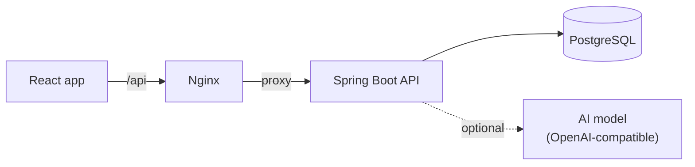

# DeskFlow

A full-stack customer support platform. Customers open tickets, agents work through them, and every new ticket is triaged automatically by an AI model, with keyword rules as a safety net.

**Stack:** Java 17, Spring Boot 4, Spring Security, PostgreSQL, Flyway, React 19, TypeScript, Docker, GitHub Actions.

## Features

- **JWT authentication** with three roles: customer, agent and admin
- **Ticket workflow** enforced by the backend: `OPEN → IN_PROGRESS → RESOLVED → CLOSED`
- **Response targets** based on priority, with overdue tracking
- **AI-assisted triage** that sets the category and priority of each new ticket
- **Internal notes** that only staff can see
- **Audit trail** of every change made to a ticket
- **Search, filters and pagination**, with filters stored in the URL
- **Team dashboard** and role management for admins
- **API documentation** with Swagger UI

## Architecture



The backend is organised by feature (`auth`, `ticket`, `user`, `ai`). Each feature follows the same path: controller → service → repository.

## Run it

### With Docker

```bash
docker compose up --build
```

Open <http://localhost:3000>. Swagger UI is at <http://localhost:8080/swagger-ui.html>.

### Without Docker

This uses an in-memory H2 database, so all data is lost when the backend stops.

```bash
cd backend
./mvnw spring-boot:run -Dspring-boot.run.profiles=dev
```

```bash
cd frontend
npm install
npm run dev
```

Open <http://localhost:5173>.

### Demo accounts

These accounts are only created when demo data is enabled.

| Role | Email | Password |
| --- | --- | --- |
| Customer | `customer@deskflow.test` | `Demo1234!` |
| Agent | `agent@deskflow.test` | `Demo1234!` |
| Admin | `admin@deskflow.test` | `Demo1234!` |

## AI triage

Triage is off by default, and the keyword rules are used instead. To turn it on, point the app at any OpenAI-compatible server. For example, with [Ollama](https://ollama.com) running locally in Docker:

```bash
AI_ENABLED=true docker compose --profile ai up --build
docker compose exec ollama ollama pull llama3.2
```

The design treats the model as an unreliable outside service:

- The call runs **before** the database transaction, so a slow model never holds a connection.
- A timeout, an error or an invalid reply **falls back to the keyword rules**, so tickets can always be created.
- The reply must match the allowed enum values, and the prompt tells the model to treat ticket text as data. This limits **prompt injection**.

## Tests

```bash
cd backend && ./mvnw test
cd frontend && npm test
```

Backend tests run through the real security chain and database schema. They use H2 locally and PostgreSQL in CI, by setting `DB_URL`, `DB_USER` and `DB_PASSWORD`.

## CI/CD

Each push runs [`.github/workflows/ci.yml`](.github/workflows/ci.yml):

1. Backend tests on PostgreSQL
2. Frontend tests and production build
3. A smoke test that starts the full stack and logs in the way a browser does
4. On `main`, publishes Docker images to GitHub Container Registry

## Design decisions

| Decision | Why |
| --- | --- |
| Workflow rules live in the `Ticket` entity | The rules cannot be bypassed by a new endpoint |
| Optimistic locking with `@Version` | Two agents cannot silently overwrite each other |
| 404 instead of 403 for another customer's ticket | Ticket ids reveal nothing about what exists |
| Stateless JWT | Any backend instance can serve any request |
| Flyway migrations with `ddl-auto: validate` | Schema changes are versioned, and a mismatch stops the app at startup |
| `@EntityGraph` on list queries | Avoids the N+1 query problem |

## Possible next steps

- Refresh tokens, and rate limiting on the login endpoint
- Email notifications when a ticket changes
- File attachments on tickets
- Real-time updates with WebSockets

## License

[MIT](LICENSE)
